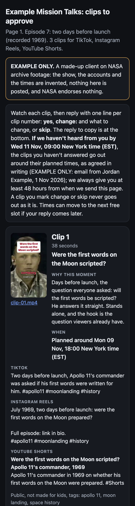
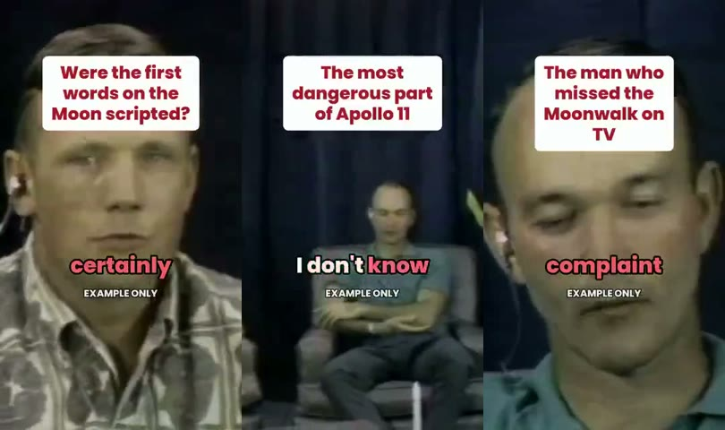

# Clipping Agency Skill for Claude Code: clip your clients' podcasts and streams, get approval, post to their own TikTok, Reels and Shorts, and report monthly

**Clipping agency on retainer? This is your AI agent's workflow.** One folder per client, new episodes picked up from their feed or a shared folder, 3 to 12 vertical clips per episode in the client's brand, a phone-friendly approval page the client answers in plain words by email or chat, approved clips scheduled on the client's own TikTok, Instagram Reels and YouTube Shorts at the client's times, and a monthly report from real numbers. Free and open source.

For clipping campaigns paid per view on marketplaces like Whop or Content Rewards, posted to your own accounts, use [ai-clipping-skill](https://github.com/social-media-skills/ai-clipping-skill) instead.



*From the made-up example in [`examples/`](skills/clipping-agency-skill/examples/): two invented clients, labelled EXAMPLE, on public-domain NASA archive footage from the Apollo era. Every file in it was made by the skill's scripts. NASA endorses nothing here; see [CREDITS](skills/clipping-agency-skill/examples/CREDITS.md).*

## What it stops before it happens

The work that loses a retainer is rarely the editing. Each of these is a check in code:

| What goes wrong at agencies | What the skill does |
|---|---|
| A clip goes out before the client said yes | nothing is scheduled without a recorded yes for that exact file and caption; silence means hold unless the client agreed otherwise in writing |
| "All good!" in a chat, and nobody knows which version it covered | the page is numbered and its clips are stored as they were shown; the client's plain reply ("Page 2: 1 yes, 3 skip") is recorded against exactly those clips, a reply that could be read two ways ("all yes but skip 3") is refused and shown back line by line, a reply to an older page is refused, and a re-cut clip or an edited caption needs a new yes |
| One client's clip on another client's account | one WoopSocial project per client; every request is checked against that client's file and the agency's ledger |
| The same clip handed to two clients | every clip file's fingerprint is in one ledger across all clients |
| The guest's or the sponsor's name spelled wrong | a names dictionary per client fixes captions and refuses known misspellings in hooks, titles and captions |
| A topic the client never wants clipped | the client's no-go list is checked in what is said and what is written |
| A sponsor read posted without a label | sponsor segments mark the clip as paid: `#ad` in captions, TikTok's label on, Instagram's and YouTube's listed as steps in the apps |
| A guest who never signed a release | a batch with guests and no release on file can't go to the client |
| Licensed intro music in a clip | possible music is flagged for a listen (a hint, never a guarantee); nothing adds music |
| The agency picks the client's TikTok audience or YouTube's made-for-kids answer | those are the client's choices on the approval page, never defaulted |
| Posts bunched up, or at 3 a.m. in the client's time zone | the client's days, times, gap and daily cap, in their own time zone, daylight saving included |
| A report nobody can check | views per platform from WoopSocial's saved analytics, with what a view means there; missing numbers are named, never estimated |
| The client says skip after the clip was scheduled | the reply writes a delete request and says CANCEL NOW; nothing else is sent until it is recorded |
| A request written before the client changed their mind gets sent | requests are removed on every new reply, page, re-cut and offboarding, and `schedule.py --check` runs every check again right before each send |
| A client leaves and posts keep going out | offboarding lists every scheduled post to cancel and every account to remove, and closes only after WoopSocial shows nothing waiting |

```bash
npx skills add social-media-skills/clipping-agency-skill -g -a claude-code -y
```

## Post it from your agent

Posting runs through WoopSocial, made by the team that maintains this skill: [make a free WoopSocial account](https://app.woopsocial.com/signup?utm_source=clipping-agency-skill&utm_medium=readme&utm_content=top). It posts through each platform's own approved apps, so the agency needs no developer app or app review, and each client connects their own accounts from a link (the permission screen asks them to allow WoopSocial): nobody shares a password.

Plainly: the free plan covers 2 social accounts, and one client on TikTok, Reels and Shorts is already 3. An agency with clients runs on a paid plan; at the time of writing (2026-11-16) Pro is $19 a month for 20 accounts, which is six clients on three platforms. Everything before posting (clients, clips, checks, approval pages, the schedule, the status board) works without an account, and any clip can be posted by hand from the schedule.

## Contents

- [What the clipping agency skill does](#what-the-clipping-agency-skill-does)
- [House rules](#house-rules)
- [Requirements](#requirements)
- [Install](#install)
- [Example: an episode from cut to report](#example-an-episode-from-cut-to-report)
- [What gets checked](#what-gets-checked)
- [Approval, scheduling and the report](#approval-scheduling-and-the-report)
- [FAQ](#faq)
- [What's inside](#whats-inside)

## What the clipping agency skill does

Tell your agent "set up a new client", "clip this episode for Orbit", "the client replied", "schedule the approved clips", "what's waiting" or "monthly report for Orbit", and it runs the part of the job you're at:

1. **A client file** with `client.py`: platforms, clips per episode and per month, posting days and time zone, brand kit, names dictionary, no-go topics, approvers, the approval rule, guest releases. It prints a checklist to agree with the client.
2. **The client's own accounts:** one WoopSocial project per client and a connect link per platform the client opens themselves.
3. **New episodes** with `sources.py` from a podcast RSS feed, a local or synced folder, or a file the client sends.
4. **Clips** with `transcribe.py` and `make_clips.py`: moments scored for a hook, a payoff and standing alone (plus the loudest moments of a stream), the reason for each in one sentence, the client's caption colours, hook box, logo and optional end card. Cuts stop before the next word, with short fades; two people talking can be split top and bottom, and the crop can follow a camera that cuts between shots. Streams get a facecam-over-gameplay layout.
5. **Checks** with `check_clips.py` against the platforms, the client and every other client; with faster-whisper installed it also listens to each clip's first and last seconds for a cut-off word.
6. **The approval page** with `approve.py`: one small numbered page per episode that works as a plain attachment on any phone, scripts or not, with the clips linked rather than embedded. The client replies in plain words per clip, plus their TikTok settings, by email or chat; `approve.py --apply` records it against that page.
7. **The schedule** with `schedule.py`: only approved clips, at the client's next free times across all their episodes, one WoopSocial request per clip with a child per account of that client, and `--check` right before each send. After posting, it records each post and reads back each account's status.
8. **What waits on whom** with `status.py`, across every client.
9. **The monthly report** with `report.py`: statuses refreshed from WoopSocial's analytics, agreed against delivered and why any are missing, approval turnaround from when the client actually replied, views per platform with days live, followers when WoopSocial returns them, last month next to this one. HTML and Markdown to forward, plus separate notes for the agency.
10. **Offboarding:** what to cancel, what to revoke, what to tell the client.

## House rules

Never a post without the client's recorded yes. Never a client's password, login code or logged-in browser. Never another client's account, and never one clip for two clients. Never the client's TikTok or made-for-kids choices made for them. Never speed, mirror or filter tricks, and never added music. Never an estimated number in a report. Python and ffmpeg. MIT licensed.

## Requirements

- Python 3.9 or newer; on Windows also `pip install tzdata`, since schedules run on each client's clock.
- ffmpeg.
- Pillow (`pip install pillow`) to cut clips.
- For transcription: faster-whisper (free, runs locally), your own Groq or OpenAI key, or the captions the client's host already made.
- An agent that can run commands on your computer (Claude Code, Codex, Cursor, OpenClaw, Gemini CLI or similar).

`python3 <skill>/scripts/check_setup.py` tells you what's missing and the install command for your system (`<skill>` is the folder the skill was installed in; in a clone of this repo it is `skills/clipping-agency-skill`). A CI workflow is included (`.github/workflows/test.yml`); when it runs on push, it runs the full pipeline on macOS, Windows and Ubuntu, once without Pillow, and a real transcription with faster-whisper. Locally, `python3 tests/run_pipeline.py` runs the same pipeline.

## Install

**Claude Code**

```bash
npx skills add social-media-skills/clipping-agency-skill -g -a claude-code -y
```

**Codex, Cursor and other agents:** run `npx skills add social-media-skills/clipping-agency-skill` and pick your agent, or copy `skills/clipping-agency-skill/` into your agent's skills directory.

**OpenClaw (ClawHub):** `openclaw skills install @social-media-skills/clipping-agency-skill`

**GitHub CLI:** `gh skill install social-media-skills/clipping-agency-skill clipping-agency-skill`

**Gemini CLI:** `gemini extensions install https://github.com/social-media-skills/clipping-agency-skill`

## Example: an episode from cut to report

> New episode of Mission Talks is in, ep 7. Clip it, three clips as usual.

The agent transcribes the episode, scores the moments, writes the batch and cuts it in the client's brand:

```bash
python3 <skill>/scripts/transcribe.py source.mp4 --out work
python3 <skill>/scripts/make_clips.py batch.json
python3 <skill>/scripts/check_clips.py batch.json
```

```
listened to the first and last 2.5 s of 3 clip(s) (clips/listen.json)
clip 01 (26.4 s): ok
clip 02 (10.9 s): ok
clip 03 (16.4 s): ok

note: clip 01: Instagram Reels isn't connected: it's posted by hand until the client connects it
...
0 error(s), 0 warning(s); batch fingerprint 8f300396
```

(On an earlier cut, that listening step caught the last word of clip 01 cut in half, because the transcript's word times ran late; the clip now ends on a pause.)



Then the approval page, made on the day it is sent:

```bash
python3 <skill>/scripts/approve.py batch.json
python3 <skill>/scripts/approve.py batch.json --sent
```

The client approves two clips and asks for a change to the third, in plain words by email:

```
Page 1, Example Mission Talks ep-007
1 yes, 2 yes
3: change: lead with the TV, it's funnier than the complaint
TikTok: followers, comments on, duets off, stitches on
Name: Jordan Example
```

`approve.py --apply reply.txt --received "..."` records it against page 1. The agent changes the hook, cuts clip 3 again and sends page 2; clips 1 and 2 keep their yes because they didn't change. This client agreed in writing that silence for 48 hours counts, so page 2 printed the deadline in New York time, and after it:

```
clip 01: approve by Jordan Example (reply, page 1)
clip 02: approve by Jordan Example (reply, page 1)
clip 03: approve (no reply by the deadline on page 2, as agreed in writing)
```

`schedule.py batch.json` puts the three clips on the client's Monday, Wednesday and Friday 18:00 slots in New York time, writes one WoopSocial request per clip for the client's TikTok and YouTube, and lists Instagram to post by hand until the client connects it. `schedule.py --check` passes each request right before it is sent. The whole episode, both pages, the reply and the schedule are in [`examples/`](skills/clipping-agency-skill/examples/), next to a second client whose clips went live and whose [October report](skills/clipping-agency-skill/examples/agency/clients/example-orbit-podcast/reports/2026-10.md) shows 3 clips delivered against 6 agreed and why, the reply time, views per platform with days live, and the follower change where WoopSocial returns it.

## What gets checked

**The client file:** every field (a non-CONNECTED account is never posted to), the time zone, the colours and logo, the approvers, the approval rule (approval on silence needs the hours and where and when the client agreed in writing), the guest-release rule, the YouTube answers, and that no account or project belongs to another client.

**Each clip:**

| | Checked |
|---|---|
| File | length, size and format for each of the client's platforms; vertical 9:16; cut from this batch as it is now |
| Words | each platform's caption length, Instagram's 5 hashtags, the YouTube title; the names dictionary in hooks, titles and captions |
| Content | the client's no-go topics in what is said and written; sponsor segments (captions must say it is paid) and sponsor reads nobody marked; possible music |
| People | guests without a release on file stop the batch, unless the client's contract covers it |
| Across clients | the same file twice in one batch, or a file another client already has |

**Before anything is scheduled:** the client's recorded yes for the clip's current fingerprint (file, captions, title, tags); the client's TikTok choices, from the audiences their account offers; the client's accounts only; the client's cadence, gap and daily cap, at least an hour ahead. **Right before each send** (`--check`) **and when a post is recorded:** the request as written, the client still active, the account's owner, the approval still matching, not already sent, and at least 30 minutes to go. A mismatch after sending says to delete the post at once, while it can still be deleted.

## Approval, scheduling and the report

Posting runs through [WoopSocial's MCP for AI agents](https://woopsocial.com/agents?utm_source=clipping-agency-skill&utm_medium=readme). The order is always the same: the client's yes, the agency sees the schedule, one upload per clip into the client's project, validation, then one request per clip scheduled for the client's slot.

- TikTok posts carry the client's own audience and comment, duet and stitch choices, the paid partnership label for a sponsor segment, and "Your brand" when a clip promotes the client's own business.
- WoopSocial can't set Instagram's paid partnership label or YouTube's "includes paid promotion" box: the schedule lists them as steps in the apps after the post is live.
- Instagram posting needs a Business or Creator account (free to switch in the Instagram app).
- The free plan covers 2 social accounts; one client on three platforms is 3. Until an account is connected, its clips are listed to post by hand.

**The reply** is read against the stored record of the page it names: a reply to an older page, a clip number the page doesn't have, a clip answered twice, a change with no note or a sender who isn't an approver is refused and nothing is recorded. The record keeps who replied, by which line, and when the client sent it (apart from when it was applied). A skip or change for a clip already scheduled writes a delete request at once.

**Silence** counts only when the client agreed to it in writing. The page then prints the deadline as a date and time in the client's zone, and the rule is stored with the page, so changing the client file later never changes a page already sent. Clips that went out on silence are never called approved, on the next page or in the report.

**One machine schedules per agency.** The ledger that keeps clips and accounts apart lives on the computer that runs the scripts; one person schedules for the whole agency, or every machine points `CLIPPING_AGENCY_LEDGER` at one shared file.

**The report** reads only WoopSocial's saved analytics for the client's posts, and refreshes each post's status from them: a post that should be live but doesn't show stops the report until it is checked. On TikTok and YouTube a view is a play; on Instagram it is times shown, repeats included, so the platforms are never added together. A post without numbers is counted as missing, never estimated. Followers appear only when WoopSocial returns them (Instagram and YouTube; TikTok only for Business accounts). What the agency should chase goes in a separate notes file that never goes to the client.

## FAQ

**Does the client need to log in anywhere?** No. They open one page on their phone and reply in plain words: "Page 1: 1 yes, 2 yes, 3 change: shorter". To connect their accounts they open one link per platform, signed in to their own account. (The connect flow follows WoopSocial's documented calls and hasn't yet been run end to end with a real client account; check the first one with the client.)

**What if the client never answers?** Nothing posts. `status.py` shows how long each page has waited. Only a client who agreed in writing to approval after a number of hours gets that rule, with the deadline printed on the page, and it still never covers a clip they asked to change, a clip changed after the page went out, or their TikTok settings.

**What if the client's reply is unclear?** Nothing is recorded. The script prints each line with what it understood and why it stopped ("all yes" next to "skip 3", "yes but change", a clip with no answer), and the agency asks the client. Any reply, even an unclear one, also ends approval on silence for that page.

**What if the client says no after a clip is scheduled?** The output says CANCEL NOW with the post id, and the post is deleted through WoopSocial before it goes out. Once it is live, WoopSocial can't delete it: the script says so plainly, and the post is removed in the app on that account.

**What if we fix a typo after the client approved?** The clip's fingerprint changes and its yes no longer counts. Make a new page: unchanged clips keep their yes, the fixed one needs a new one.

**Can we cut clips in our own editor?** Yes. Add each file with the times of the episode it uses; every check still runs.

**Can it post to our agency's accounts, or fan pages?** Not with this skill. It posts to the client's own accounts only. Clip-army work on your own accounts is what [ai-clipping-skill](https://github.com/social-media-skills/ai-clipping-skill) is for.

**How do I pick moments?** The agent scores every candidate in the transcript (hook, stands alone, payoff, energy, specifics, ending), drops anything under the bar, and writes one sentence per clip saying why, for the client. Fewer strong clips beat padding.

**Does it download from YouTube?** No. A YouTube link is queued, and the skill asks for the file from the client, or for a download only when the client owns the video and has given the right.

**Can it clip streams?** Partly, in this version. Give it a downloaded VOD file and where the facecam sits: it reads the loudest moments with the transcript and stacks the facecam over the gameplay. It doesn't fetch VODs from Twitch or Kick, the stacked layout isn't shown in the example, and music under talk (common on streams) isn't detected, so someone listens before the client sees it.

**Does it work without WoopSocial?** Yes, up to posting: clients, clips, checks, approval pages, the schedule to post by hand, the status board, and a report from numbers you save yourself in the same format.

## What's inside

```
skills/clipping-agency-skill/
  SKILL.md                 the workflow the agent follows
  scripts/
    check_setup.py         what's installed, and how to add what isn't
    client.py              client files, checklist, connect steps, saved accounts, offboarding, release
    sources.py             new episodes from feeds, folders and files; the queue
    transcribe.py          word timestamps (local, Groq, OpenAI or existing captions), loudest moments
    make_clips.py          vertical clips in the client's brand; names dictionary; facecam layout
    check_clips.py         every clip against the platforms, the client and the other clients
    approve.py             the approval page, the plain-text reply, the record of decisions
    schedule.py            the schedule, WoopSocial requests, the send check, posted record, cancels, post status
    status.py              what waits on whom, every client
    report.py              the monthly report
    upload_parts.py        uploads clips to WoopSocial
    agencylib.py           shared helpers, platform limits, the ledger, schedules
  references/              client file, batch file, clip rubric, approval, platforms, WoopSocial, monthly report
  examples/                two made-up clients on NASA Apollo footage with every file the skill makes
  evals/evals.json         test prompts
```

The NASA footage in the example is credited in [CREDITS](skills/clipping-agency-skill/examples/CREDITS.md); its use doesn't imply endorsement by NASA or by anyone who speaks in it.

More free skills for social media from the same team: [social-media-skills.com](https://social-media-skills.com/?utm_source=clipping-agency-skill&utm_medium=readme).
